## Jobsheet 7
*Nama:* Shafiqa Nabila Maharani Khoirunnisa
*NIM:* 244107020221
*Kelas:* TI-3E

## Langkah-langkah beserta bukti Screenshoot:
### LAPORAN PRAKTIKUM WEEK07

<h3>JOBSHEET 7</h3>

<blockquote>

### Langkah Praktikum :

## Praktikum 1: Audit layer project lama

2. Tandai tiga pelanggaran klasik
Cari dengan grep di project Anda:
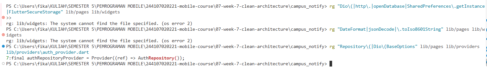

3. Gambar struktur target
Untuk satu fitur (notes atau announcements):
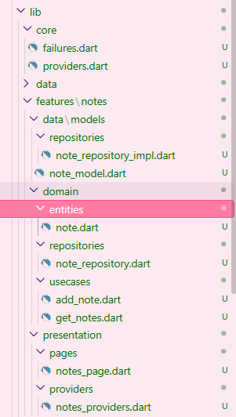

## Praktikum 2: Domain dan data per fitur
1. Entity murni (domain)
Buat lib/features/notes/domain/entities/note.dart. Tanpa import Flutter, tanpa mapping:
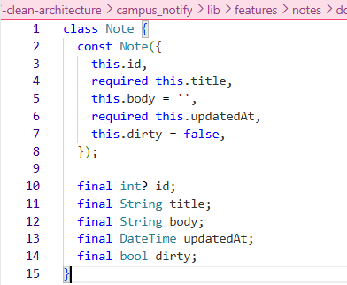

2. Failure dan kontrak repository (domain)
Buat lib/core/failures.dart dan lib/features/notes/domain/repositories/note_repository.dart:
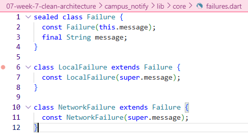
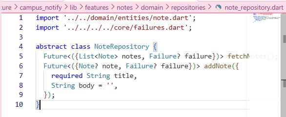

3. Model dan implementasi (data)
Buat lib/features/notes/data/models/note_model.dart (mapping hanya di sini) dan note_repository_impl.dart:
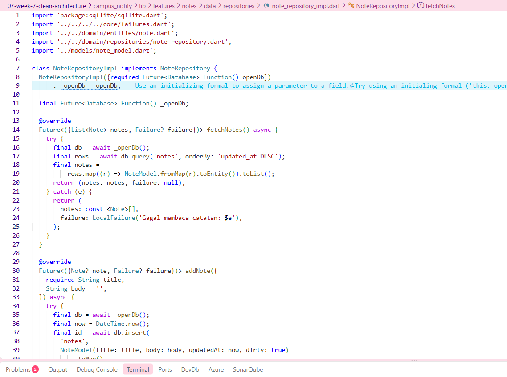

4. Use case: satu operasi bisnis
Buat lib/features/notes/domain/usecases/get_notes.dart:
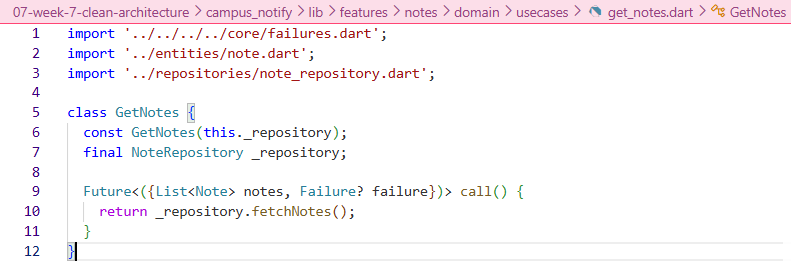
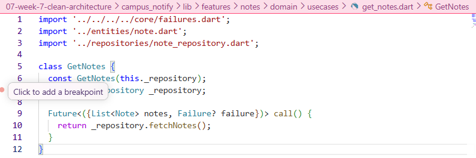
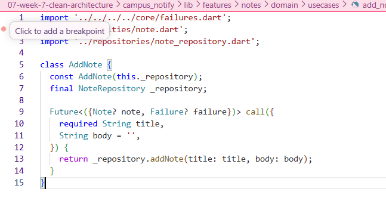

## Praktikum 3: Presentation, DI, dan verifikasi
1. Dependency injection dengan Riverpod
Buat lib/features/notes/presentation/providers/notes_providers.dart. Inilah satu-satunya tempat wiring:
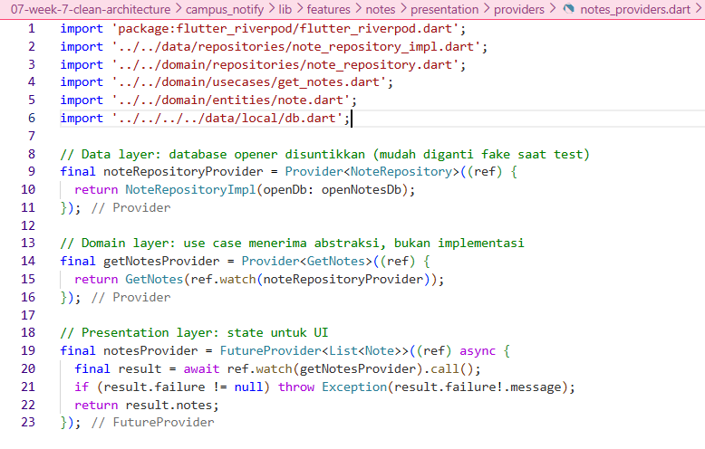

2. Halaman hanya membaca state
notes_page.dart versi bersih tidak mengandung SQL, Dio, JSON, atau formatting tanggal mentah:
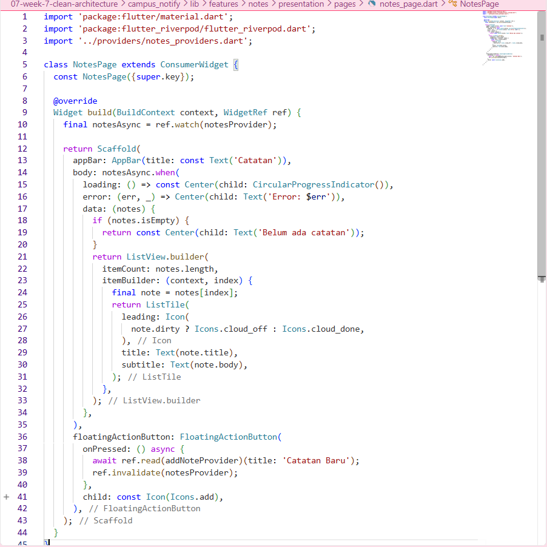

3. Verifikasi dependency rule
Jalankan tiga pemeriksaan ini; semuanya harus lolos:
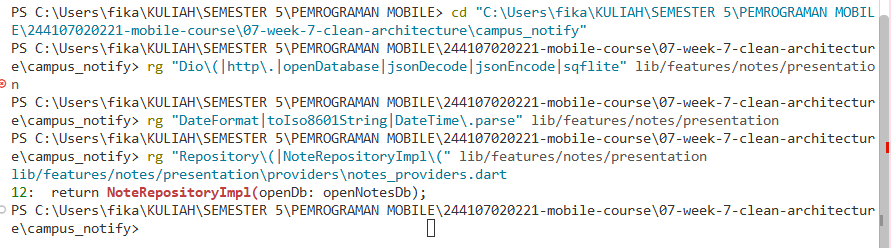

## AI Challenge

# AI Prompt Challenge
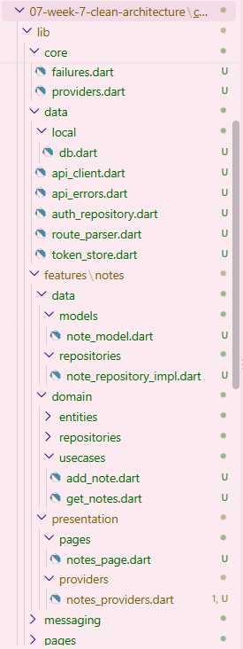

## Refactoring, testing, dan error umum

# Refactoring Challenge

1. Terapkan pola yang sama ke fitur kedua (auth atau announcements): entity + repository interface + impl + 1 use case + provider wiring. Jangan biarkan satu fitur bersih dan sisanya kotor.
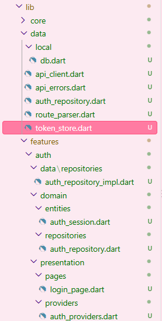

2. Ekstrak formatting tanggal dan parsing rute ke fungsi murni di lib/core/format.dart agar bisa diuji tanpa widget.
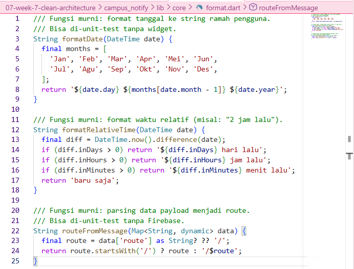

3. Pindahkan semua exception mentah menjadi Failure yang ramah pengguna sebelum mencapai UI; UI hanya menerima message.
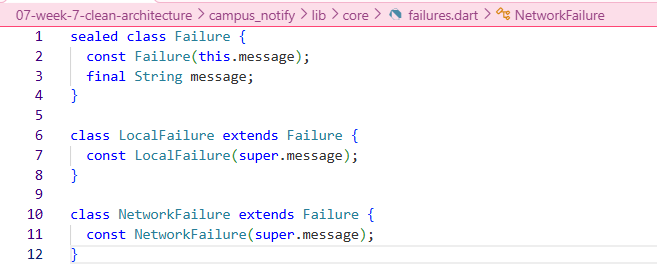
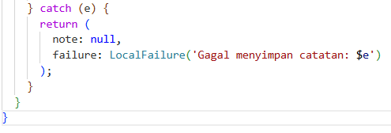
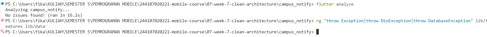

## Testing: use case dengan repository palsu
Buat test/get_notes_test.dart. Domain diuji murni — tanpa SQLite, tanpa Dio, tanpa Firebase:
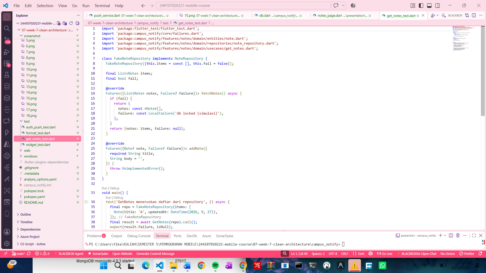
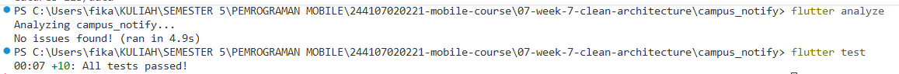

## Tugas, refleksi, dan referensi

# Refleksi
1. Mengapa interface repository harus tinggal di domain, bukan di data? Apa yang rusak bila dibalik?
- Interface repository harus tinggal di domain karena domain itu pusat aplikasi yang tidak boleh bergantung pada detail implementasi seperti database atau API. Kalau interface ditaruh di data, dependency rule jadi terbalik — domain malah bergantung pada data, padahal seharusnya data yang bergantung pada domain. Akibatnya, use case di domain harus import implementasi dari data, yang berarti butuh SQLite atau Dio untuk di-test. Padahal domain harus bisa diuji murni tanpa database. Selain itu, kalau mau ganti database, domain juga harus ikut diubah, padahal domain tidak boleh tahu detail data. Jadi, interface di domain membuat domain tetap murni, dan data yang menyesuaikan.

2. Kapan use case benar-benar dibutuhkan, dan kapan repository langsung ke notifier sudah cukup?
- Use case dibutuhkan ketika ada logika bisnis yang kompleks, operasi multi-step, atau logika yang dipakai ulang di banyak tempat. Misalnya AddNote yang perlu validasi judul dan set dirty, atau Login yang perlu validasi email dan simpan token. Tapi untuk operasi CRUD satu-baris yang tidak ada logika bisnisnya, seperti FetchNotes yang cuma ambil data, repository langsung ke notifier sudah cukup. Jadi, use case itu bukan kewajiban, tapi alat yang dipakai kalau memang ada logika bisnis yang perlu dipisah.

3. Apa biaya over-engineering (use case per CRUD satu-baris) bagi tim kecil? Kapan biayanya sepadan?
- Biaya over-engineering untuk tim kecil itu lumayan besar. Setiap operasi CRUD sederhana jadi butuh tiga file — use case, repository, dan provider. Waktu development jadi lebih lama, boilerplate menumpuk, dan developer baru bisa bingung kenapa harus lewat tiga lapisan hanya untuk operasi simpel. Maintenance juga lebih berat karena perubahan kecil harus diubah di banyak tempat. Tapi biaya ini sepadan kalau timnya besar (lima orang atau lebih), aplikasinya kompleks dengan banyak logika bisnis, atau aplikasinya jangka panjang dan butuh struktur yang jelas. Jadi, untuk tim kecil dan CRUD simpel, repository langsung lebih efisien.

4. Bagian mana dari usulan AI yang Anda tolak atau sederhanakan, dan mengapa?
- Dari usulan AI, saya menolak beberapa hal. Pertama, AI menyarankan use case untuk setiap operasi, termasuk FetchNotes yang cuma ambil data — saya tolak karena itu over-engineering, cukup repository langsung ke notifier. Kedua, AI menyarankan pakai package dartz atau fpdart untuk Either<Failure, T> — saya sederhanakan dengan record Dart yang lebih simpel dan tanpa package tambahan. Ketiga, AI menyarankan use case untuk Logout yang cuma hapus token — saya tolak karena tidak ada logika bisnis. Tapi saya terima saran AI untuk memisahkan AuthRepository menjadi interface dan implementasi. Intinya, clean architecture harus disesuaikan dengan kompleksitas, bukan diterapkan mentah-mentah.