## Jobsheet 8
*Nama:* Shafiqa Nabila Maharani Khoirunnisa
*NIM:* 244107020221
*Kelas:* TI-3E

## Langkah-langkah beserta bukti Screenshoot:
### LAPORAN PRAKTIKUM WEEK08

<h3>JOBSHEET 8</h3>

<blockquote>

### Langkah Praktikum :

## Praktikum 1: Hygiene branch dan commit
1. Audit riwayat Anda
Jalankan di repository project Minggu 5–7:
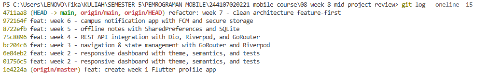
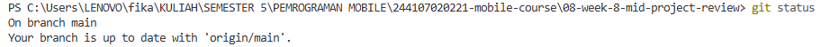
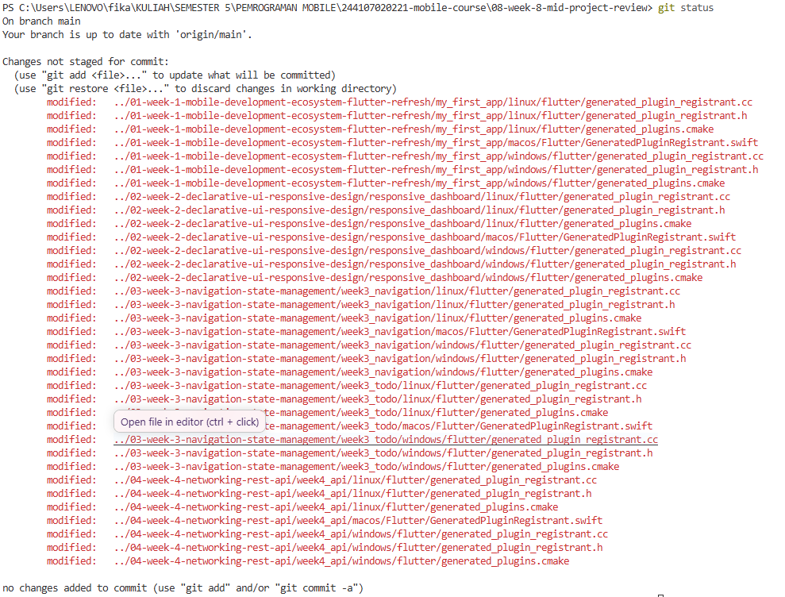

2. Buat branch kerja yang benar
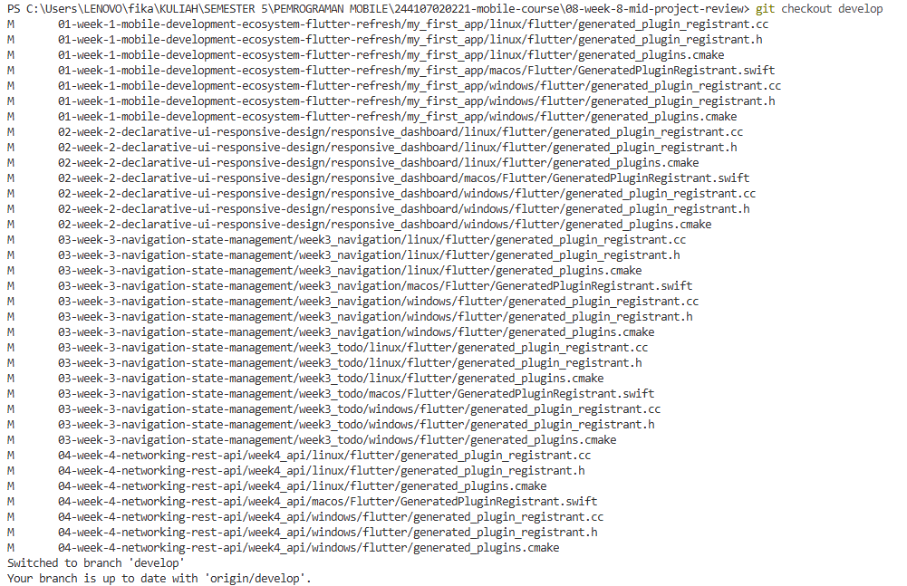
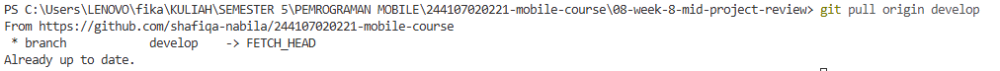
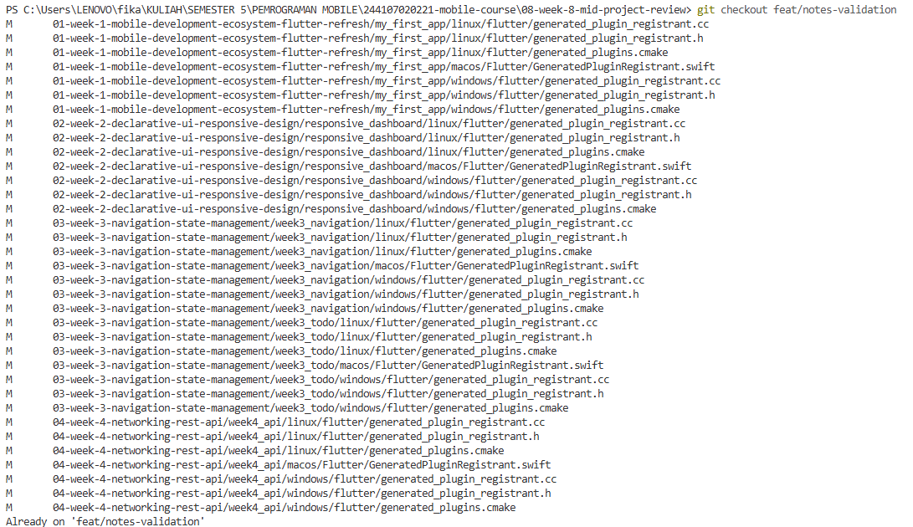
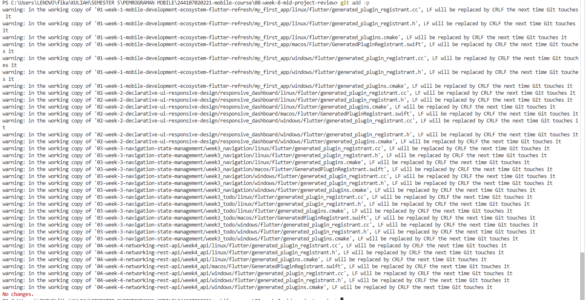
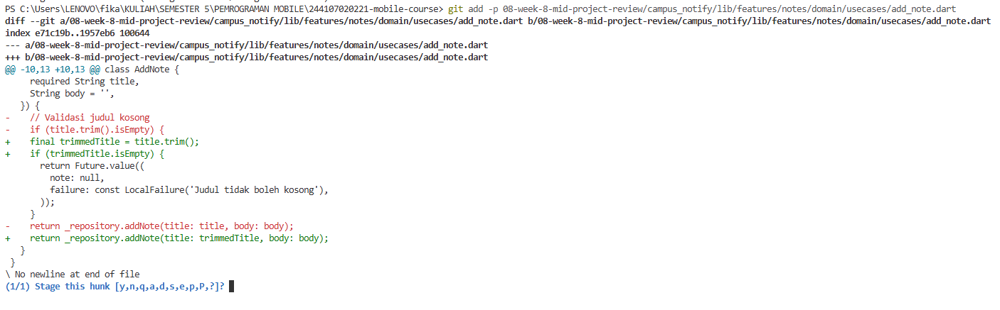
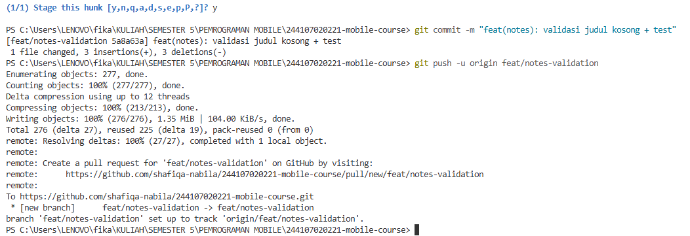

3. Perbaiki satu commit buruk (simulasi)
Buat tabel sebelum/sesudah di docs/review-checklist.md: tulis ulang 3 pesan commit lama Anda menjadi format konvensional beserta alasannya. Contoh: fix bug → fix(notes): cegah simpan judul kosong + test (jelas apa, di mana, dan buktinya).
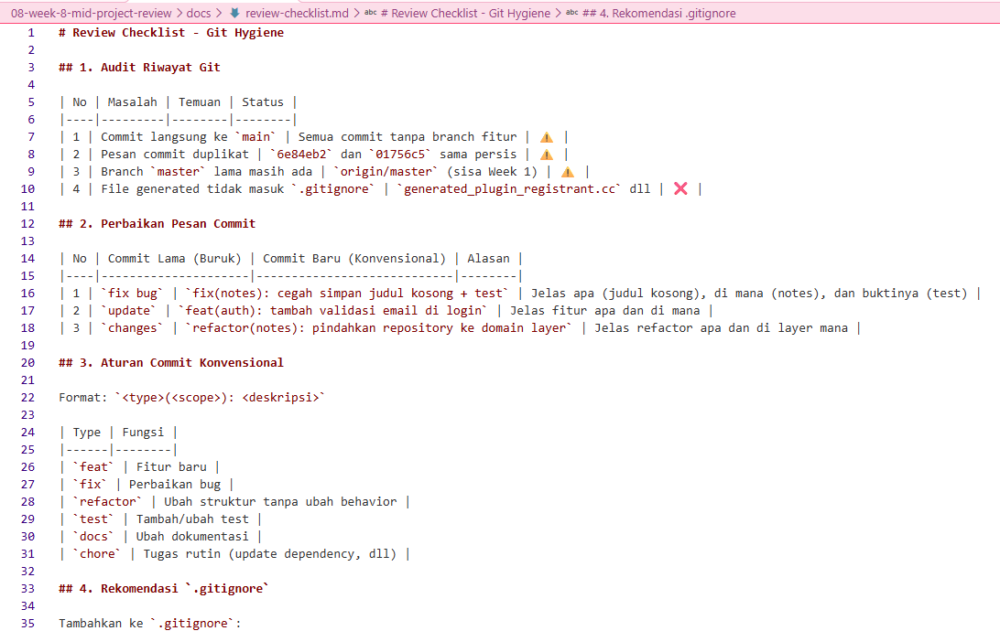
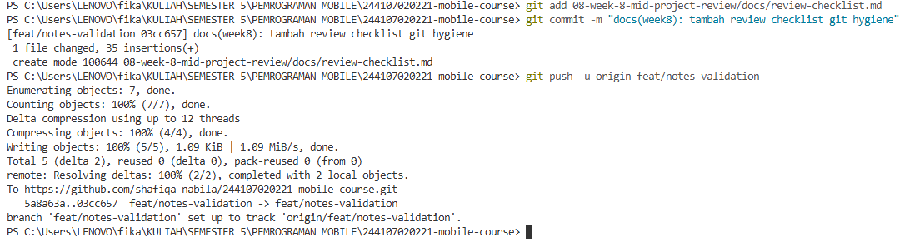

## Praktikum 2: PR dan peer review
1. Buka PR kecil
Dari branch feat/notes-validation, buka PR ke develop dengan template:
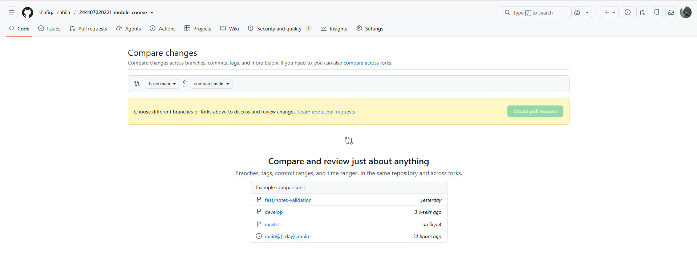
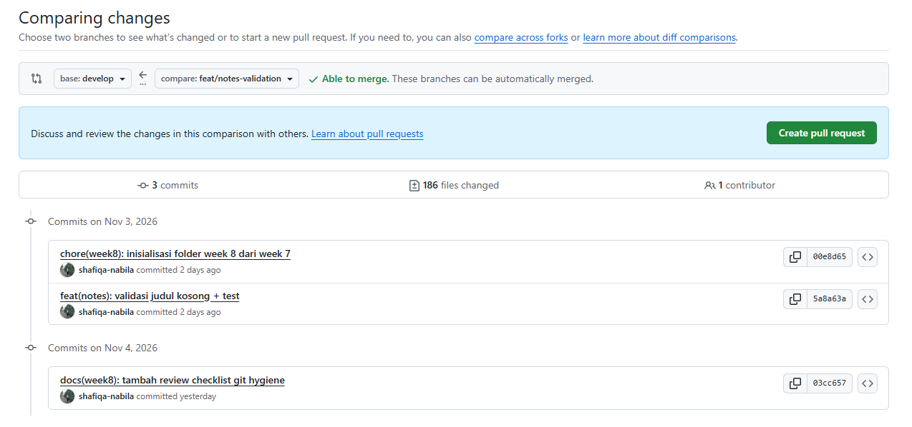
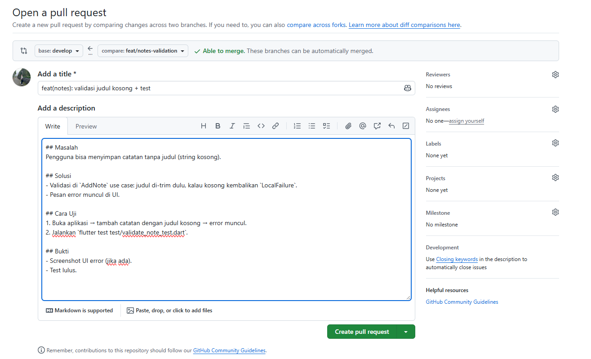
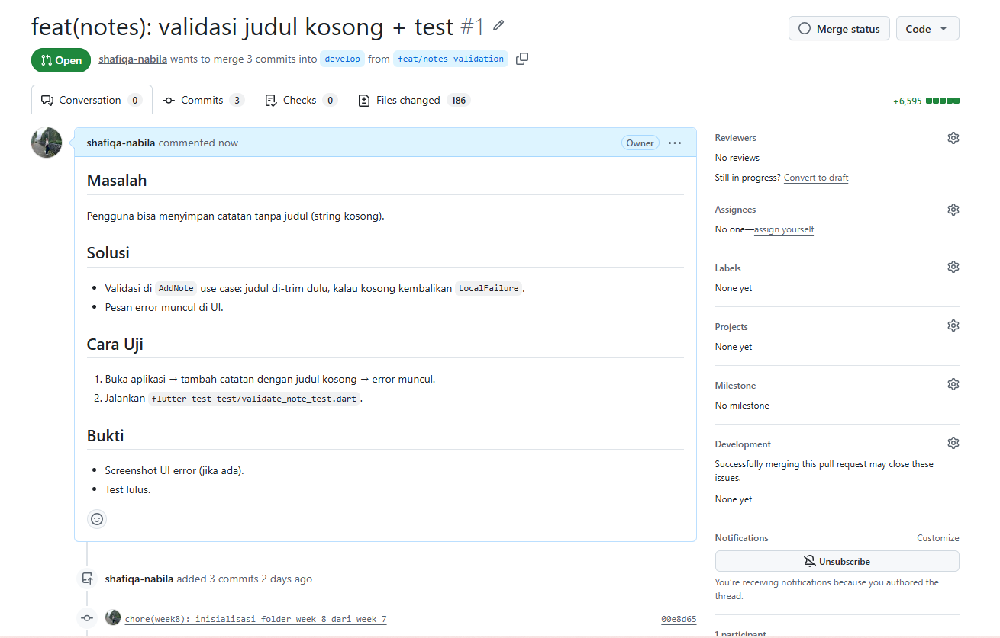

2. Review sejawat 15 menit
Tukar PR dengan pasangan. Reviewer wajib menghasilkan minimal:
- 2 temuan kebenaran (null, state, error path, edge case).
- 1 temuan arsitektur (import lintas layer, DI bocor, model bocor ke UI).
- 1 temuan test (kasus sukses/gagal kurang) dan 1 saran keterbacaan.
- Keputusan akhir: Approve atau Request changes.

PR Fifa di review fika :
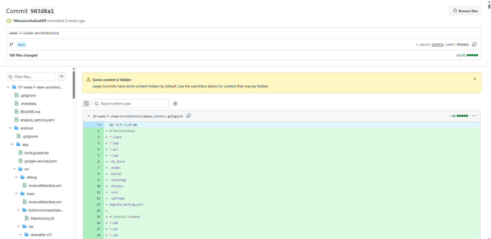
PR Fika di review fifa :
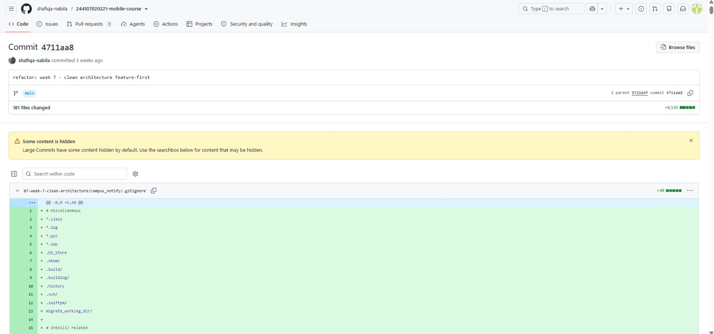

Praktikum 3: Static analysis dan mid review
1. Bersihkan dengan mesin
Jalankan tiga perintah ini di project Anda; semuanya harus hijau sebelum PR diminta review:
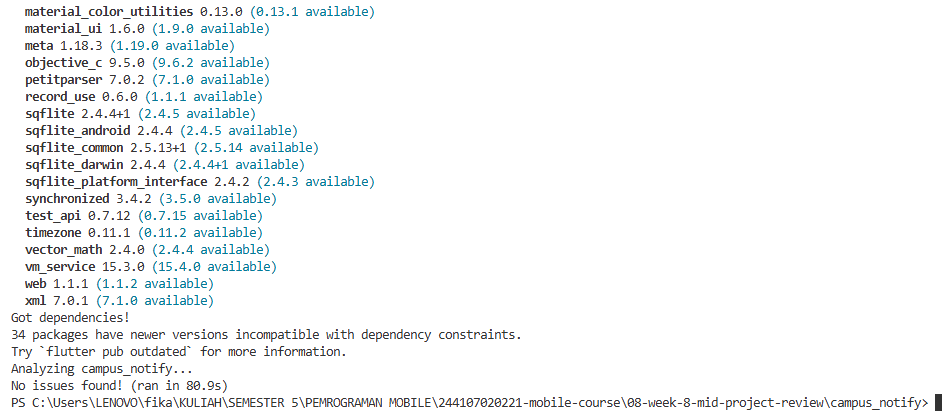
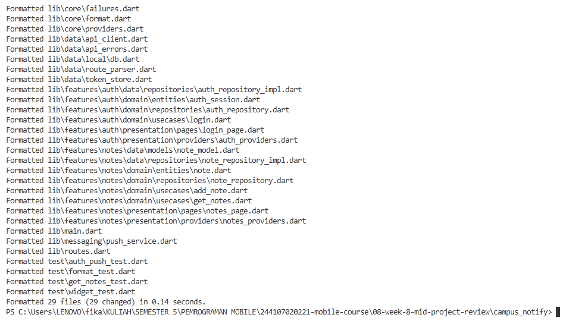
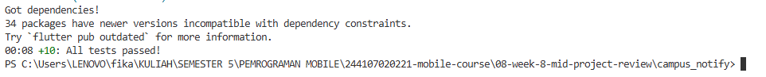

2. Aktifkan penolakan otomatis (CI)
Buat .github/workflows/ci.yml minimal agar PR kotor ditolak mesin sebelum dibaca manusia:
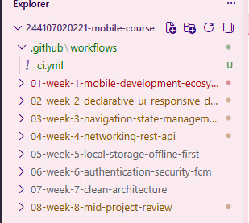
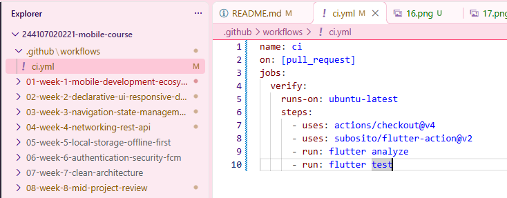
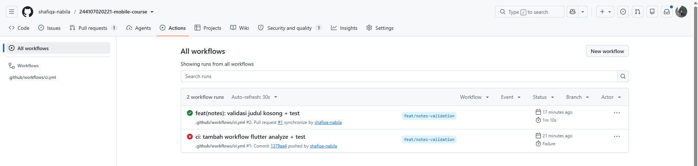

## AI Challenge: Review PR

AI menemukan 5 hal:

2 blocker (test kurang).
3 saran (body null, DatabaseException, hardcode token).

Setelah verifikasi:
2 temuan benar (test kurang) → diterima.
1 temuan ditolak (DatabaseException sudah ditangani) → ditolak dengan alasan.
1 temuan ditolak (body non-nullable) → ditolak.
1 temuan diterima sebagian (hardcode token) → ditambah TODO.

Semua saran yang diterima tetap patuh pada dependency rule.

## Testing: review tanpa dijalankan tidak sah
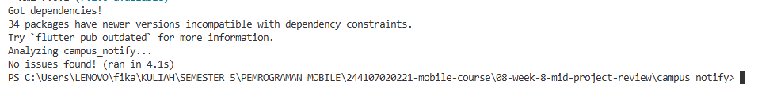
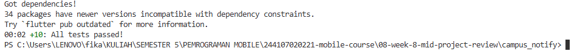

## Refleksi
1. Apa beda LGTM buta dengan approve yang bertanggung jawab? Apa risikonya bagi tim?
- LGTM buta itu approve tanpa benar-benar memeriksa kode, cuma lihat sekilas lalu klik approve. Sedangkan approve yang bertanggung jawab itu dilakukan setelah reviewer checkout branch, jalankan test, cek dependency rule, dan uji manual fitur yang berubah. Risiko LGTM buta bagi tim sangat besar karena bug bisa lolos ke develop, arsitektur bisa rusak tanpa terdeteksi, test palsu bisa lulus tanpa menguji apa pun, dan review jadi formalitas belaka. Intinya, LGTM buta lebih berbahaya daripada tidak ada review sama sekali karena memberi rasa aman palsu.

2. Kapan komentar wajib berstatus request changes, dan kapan cukup saran?
- Komentar wajib berstatus request changes ketika ada bug yang bisa membuat aplikasi crash atau data hilang, ada pelanggaran arsitektur seperti domain mengimpor Flutter atau data layer, ada test yang gagal atau tidak ada untuk perilaku baru, ada celah keamanan seperti token di-log, atau ada behavior yang berubah tapi tidak ada bukti uji. Sedangkan cukup saran ketika masalahnya cuma style seperti penamaan variabel atau format yang bisa ditangani dart format, optimasi yang tidak mendesak seperti pakai const, dokumentasi tambahan, atau refactor kecil yang tidak mengubah behavior. Jadi, request changes untuk hal yang mempengaruhi kebenaran atau keamanan, dan saran untuk hal yang meningkatkan kualitas tapi tidak memblokir.

3. Bagian mana dari review AI yang Anda tolak atau sederhanakan, dan mengapa?
- Dari review AI, saya menolak dua hal. Pertama, AI menyarankan body bisa null, padahal di Dart tipe String itu non-nullable, jadi body tidak bisa null dan validasi defensif untuk body tidak perlu. Kedua, AI menyarankan DatabaseException belum ditangani, padahal di note_repository_impl.dart catch (e) sudah mengembalikan LocalFailure, jadi AI sepertinya melihat versi lama. Saya menerima temuan tentang test add_note_test.dart dan test auth yang kurang, dan langsung menambahkannya. Intinya, review AI berguna untuk menangkap yang terlewat, tapi harus diverifikasi dengan grep atau test, jangan diterima mentah.

4. Satu hal konkret yang Anda perbaiki setelah review sejawat — apa dampaknya?
- Setelah review sejawat, saya menambahkan test/add_note_test.dart. Dampaknya, validasi judul kosong sekarang teruji otomatis, jadi kalau ada perubahan di AddNote, test akan menangkap regresi. CI juga sekarang menolak PR kalau test gagal, sehingga bug tidak bisa lolos ke develop. Reviewer berikutnya bisa langsung lihat bahwa validasi sudah diuji tanpa perlu uji manual lagi. Sebelumnya validasi judul kosong ada di kode tapi tidak ada bukti bahwa itu bekerja, sekarang ada dua test yang membuktikan validasi bekerja untuk judul kosong dan judul valid.