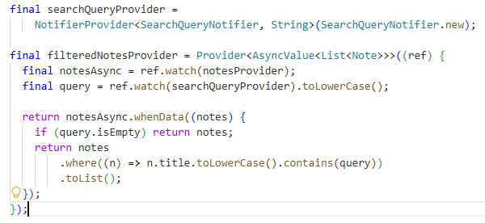
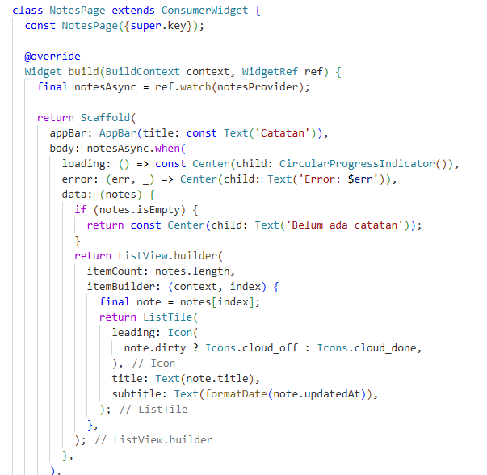
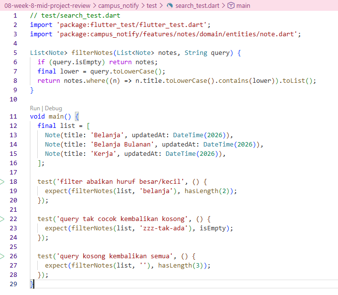
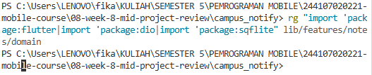
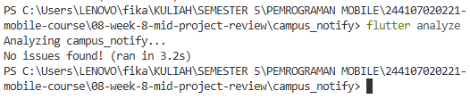
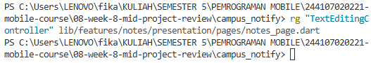
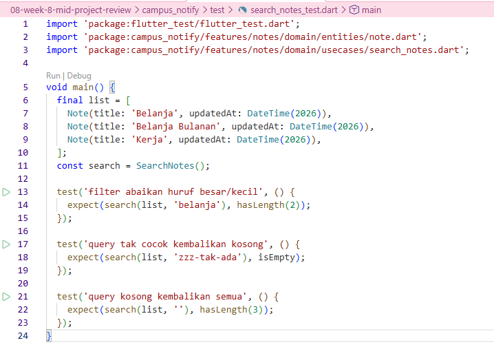

## Jobsheet 9
*Nama:* Shafiqa Nabila Maharani Khoirunnisa  
*NIM:* 244107020221  
*Kelas:* TI-3E  

## Langkah-langkah beserta bukti Screenshoot:
### LAPORAN PRAKTIKUM WEEK09

<details>
<summary><h3>JOBSHEET 9</h3></summary>

<blockquote>

### Langkah Praktikum :

## Praktikum 1: Prompt dan context engineering

# Prompt Engineering - Week 9

1. Formula 5 Slot

| Slot | Isi |
|------|-----|
| Peran | Senior Flutter dev |
| Konteks | feature-first Clean Architecture, Riverpod, SQLite |
| Tugas | Tambah search judul notes + empty state |
| Batas | Jangan ubah arsitektur, max 80 baris |
| Output | Kode + 3 test case + cara uji |

2. Prompt Buruk vs Baik

**Buruk:**
```text
"Buatkan search notes yang keren"
```
*Kelemahan:* Prompt terlalu umum, tidak memiliki batasan arsitektur, tidak mendefinisikan state management yang dipakai, dan berpotensi memicu halusinasi AI seperti memanggil database langsung dari dalam widget atau menambahkan dependensi yang tidak diperlukan.

**Baik:**
```text
"Peran: senior Flutter dev.
Konteks: feature-first Clean Architecture (presentation -> domain <- data), Riverpod 2.x, SQLite + Dio.
Tugas: tambah search judul notes + widget empty state.
Batas: jangan ubah arsitektur, jangan panggil SQLite dari widget, logika domain bebas dari package Flutter/Dio/SQLite, maksimal 80 baris.
Output: kode implementasi provider & UI + 3 unit test case + cara uji."
```

3. Konteks yang Disertakan

- Struktur folder project (`lib/features/notes/{domain, data, presentation}`).
- Kontrak repository dan entity (`note_repository.dart`, `note.dart`).
- Versi package utama dari `pubspec.yaml` (misal: `flutter_riverpod: ^2.5.1`, `sqflite: ^2.3.3`).

4. Konteks yang TIDAK Disertakan (Sanitasi Rahasia & Privasi)

- Token FCM / APNs → diganti placeholder `TOKEN_PLACEHOLDER`.
- JWT Token / Refresh Token → diganti `JWT_PLACEHOLDER`.
- API Key / Secrets / Base URL internal → diganti `API_KEY_PLACEHOLDER`.
- Password / Kredensial akun pengguna → tidak disertakan sama sekali.
- Seluruh isi repository (500+ file) → hanya melampirkan file relevan yang terkait langsung.

5. Kesimpulan

Prompt yang kabur menghasilkan kode kabur yang rapuh dan sulit diuji. Prompt terstruktur menggunakan formula 5 slot dengan sanitasi data sensitif menghasilkan kode modular, aman, dan mudah diverifikasi.

---

## Praktikum 2: Generate dan verifikasi search

1. Prompt Mentah

```text
Peran: Senior Flutter dev
Konteks: Project campus_notify, feature-first Clean Architecture, Riverpod, SQLite.
Tugas: Tambah fitur search judul notes + empty state.
Batas: Jangan ubah arsitektur (search di presentation layer), jangan panggil SQLite dari widget, max 80 baris.
Output: Kode + 3 test case + cara uji.
```

Dokumentasi prompt mentah dan output awal AI tersimpan di file `docs/ai-log.md`.

2. Output Awal AI

Berikut adalah tangkapan layar output awal yang dihasilkan oleh AI:

- **Provider Output AI (`notes_providers.dart`):**  
  

- **Widget Halaman Output AI (`notes_page.dart`):**  
  

- **Unit Test Output AI (`search_test.dart`):**  
  

3. Verifikasi 6 Langkah

1. **Baca tiap baris kode:** Menelaah setiap baris kode yang dihasilkan AI. Ditemukan potensi memory leak pada instansiasi controller dan logika filter yang belum terisolasi di layer domain.
2. **Cek import domain:** Memastikan file pada layer `domain/` murni dan bersih dari import framework/eksternal:
   ```bash
   rg "import 'package:flutter|import 'package:dio|import 'package:sqflite" lib/features/notes/domain
   ```
   
3. **Cek API:** Memastikan method `Notifier`, `AsyncValue.whenData`, dan method manipulasi List/String benar-benar tersedia pada Flutter & Riverpod.
4. **Jalankan flutter analyze:** Memastikan tidak ada peringatan atau kesalahan sintaksis:
   ```bash
   flutter analyze
   ```
   
5. **Tulis minimal 1 test sukses dan 1 test gagal:** Menguji skenario pencarian judul cocok, tidak cocok, dan penanganan query kosong.
6. **Uji manual 3 skenario:**
   - Query kosong `""`: Menampilkan seluruh daftar catatan.
   - Query cocok `"Belanja"`: Menampilkan catatan yang mengandung kata "Belanja".
   - Query tak cocok `"zzz-tak-ada"`: Menampilkan widget teks empty state.

4. Bug / Halusinasi yang Ditemukan

**Bug 1: TextEditingController Dibuat di Method `build()` Tanpa Di-dispose**  
AI mengusulkan inisialisasi controller langsung di dalam method `build()`:
```dart
final controller = TextEditingController();  // di build()
```
Hal ini menyebabkan pembuatan objek controller baru pada setiap render ulang widget, mengakibatkan kebocoran memori (*memory leak*) dan hilangnya posisi kursor.

**Bukti Pemeriksaan (Grep):**  


---

## Praktikum 3: Debug dan refactor

1. Debug dengan Test Merah

Proses perbaikan dilakukan dengan metode *Red-Green-Refactor*:
1. **Reproduksi:** Memasukkan query pencarian pada UI menyebabkan re-render yang memicu re-instansiasi controller jika menggunakan kode awal AI.
2. **Isolasi:** Memindahkan aturan pencarian dari provider/UI ke dalam Use Case murni `SearchNotes` di domain layer (`lib/features/notes/domain/usecases/search_notes.dart`).
3. **Test Merah:** Menulis test unit pembuktian di `test/search_notes_test.dart` untuk menguji use case secara independen tanpa ketergantungan widget maupun Riverpod.
4. **Perbaiki Kecil:** Mengimplementasikan fungsi `SearchNotes` dengan perlakuan case-insensitive dan penanganan query kosong/spasi hingga seluruh test menjadi hijau (*pass*).
5. **Pencatatan:** Mencatat akar masalah pada `docs/ai-log.md`.

Bukti test use case yang berhasil dieksekusi:  


2. Refactor ke Layer yang Benar

Struktur aliran data setelah di-refactor:
```text
Widget (UI Saja: TextField + Consumer ListView/Empty State)
  -> Notifier (State Saja: SearchQueryNotifier untuk menyimpan string query)
    -> Use Case (Aturan Bisnis Murni: SearchNotes memfilter List<Note>)
      -> Repository (Data Access: SQLite NoteRepositoryImpl)
```

Aturan arsitektur yang ditegakkan:
- Seluruh fungsi dipecah agar tidak melebihi 40 baris.
- Tidak ada panggilan database SQLite atau manipulasi data langsung dari dalam widget.
- Widget hanya membaca state dari `filteredNotesProvider`.

3. Verifikasi Akhir Mesin Hijau

Menjalankan perintah verifikasi menyeluruh:
- `flutter analyze` : Lolos tanpa warning (*No issues found!*).
- `dart format --set-exit-if-changed .` : Format kode rapi dan konsisten sesuai standar Dart.
- `flutter test` : Seluruh test unit dan widget test lulus (*All tests passed!*).

---

## AI Challenge

# Peran AI pada Codelab Ini
AI diposisikan sebagai generator kode awal dan reviewer cepat. Setiap potongan kode dan saran dari AI tidak diterima mentah-mentah, melainkan dievaluasi secara kritis berdasarkan prinsip Clean Architecture, kebenaran fungsional, dan pengujian otomatis.

# AI Prompt Challenge
Prompt review yang diajukan ke AI:
```text
Review kode search Flutter ini sebagai senior dev.
Konteks: feature-first (presentation->domain<-data), Riverpod, SQLite + Dio.
Fokus: kebenaran, arsitektur, test. Abaikan style.
Beri 3 temuan + level blocker/saran + alasan.
```

# AI Verification Checklist

Berikut adalah 3 temuan hasil review AI beserta analisis dan keputusannya:

| No | Temuan AI | Level | Analisis Teknis | Keputusan |
|:--:|---|:---:|---|:---:|
| 1 | Inisialisasi `TextEditingController` di dalam method `build()` memicu memory leak karena tidak di-dispose. | **Blocker** | **Terbukti Benar.** Controller harus di-dispose pada `dispose()` atau dihindari sama sekali dengan memanfaatkan Riverpod Notifier secara reaktif melalui event `onChanged`. | **Terima & Perbaiki** |
| 2 | Logika filter in-memory bercampur di dalam presentation provider (`notes_providers.dart`). | **Saran Arsitektur** | **Terbukti Benar.** Menurut prinsip Clean Architecture, aturan manipulasi data dan filter merupakan logika bisnis domain yang harus tinggal di use case murni agar dapat diuji tanpa dependensi framework. | **Terima + Refactor** |
| 3 | Tambahkan query SQL `LIKE %query%` ke SQLite database dan pasang package debounce external. | **Saran** | **Ditolak.** Untuk koleksi data catatan lokal pengguna, filtering in-memory pada entity domain jauh lebih cepat, tidak membebani I/O disk, dan menjaga kesederhanaan dependensi tanpa menambah package pihak ketiga yang berlebihan (*over-engineering*). | **Tolak dengan Alasan Teknis** |

### Tabel Keputusan Tiap File

| File | Layer | Keputusan | Alasan Teknis |
|---|---|---|---|
| `search_notes.dart` | Domain | **Terima + Refactor** | Use case murni tanpa dependensi Flutter/SQLite, sangat mudah diuji secara unit test. |
| `notes_providers.dart` | Presentation | **Terima + Refactor** | Memisahkan query state notifier dengan logika eksekusi use case. |
| `notes_page.dart` | Presentation | **Tolak Awal + Tulis Manual** | Menolak kode awal AI yang mengandung memory leak; menulis ulang UI dengan TextField reaktif dan empty state. |
| `search_notes_test.dart` | Test | **Terima** | Menjamin keandalan filter pada variasi input (case-insensitive, empty, not found). |

---

## Refactoring, testing, dan error umum

# Refactoring Challenge

1. **Mengecilkan Ukuran Fungsi:** Memecah logika yang awalnya menumpuk di presentation layer menjadi use case kecil `SearchNotes` yang independen dan berfokus pada satu tanggung jawab (*Single Responsibility Principle*).
2. **Isolasi Logika Domain:** Logika pencarian diekstrak ke `lib/features/notes/domain/usecases/search_notes.dart` tanpa import package eksternal.
3. **Pembersihan Import Lintas Layer:** Menjaga agar layer domain tidak mengimpor file dari presentation maupun data layer. Hasil `flutter analyze` tetap 0 warning.

# Testing

Pengujian dilakukan secara otomatis menggunakan unit test dan widget test:
- `flutter test test/search_filter_test.dart` (Unit test filter murni)
- `flutter test test/search_notes_test.dart` (Unit test Use Case `SearchNotes`)
- `flutter test test/search_empty_state_widget_test.dart` (Widget test empty state)

### Hasil Uji Manual 3 Kasus Query

| Skenario | Input Query | Output yang Diharapkan | Hasil Pengujian | Status |
|---|---|---|---|:---:|
| Query Kosong | `""` | Menampilkan seluruh 3 catatan yang ada | Seluruh 3 catatan tampil | **Pass** |
| Query Cocok | `"Belanja"` | Menampilkan 2 catatan yang mengandung kata "Belanja" (case-insensitive) | 2 catatan tampil dengan benar | **Pass** |
| Query Tak Cocok | `"zzz-tak-ada"` | Menampilkan pesan empty state: *"Catatan tidak ditemukan"* | Empty state muncul di tengah layar | **Pass** |

# Error Umum dan Solusinya

| Gejala | Penyebab Umum | Solusi |
|---|---|---|
| Method tidak ditemukan saat kompilasi | AI berhalusinasi membuat nama method yang tidak ada pada package/SDK | Cek dokumentasi resmi di pub.dev dan manfaatkan autocomplete IDE. |
| Import lintas layer (*dependency violation*) | Konteks arsitektur yang diberikan pada prompt kurang tegas | Tegaskan batasan arsitektur (presentation -> domain <- data) dan refactor import. |
| Semua test merah (*fail*) | Prompt meminta terlalu banyak fitur sekaligus | Pecah permintaan menjadi satu fitur kecil bertahap beserta satu test case. |
| Prompt perbaikan diulang-ulang tanpa hasil | Tidak menyertakan pesan error atau langkah reproduksi yang jelas | Buat test merah terlebih dahulu untuk mereproduksi bug sebelum meminta solusi. |
| Tidak bisa menjelaskan kode yang dibuat AI | Menerima kode AI mentah-mentah tanpa dibaca | Baca ulang baris demi baris, sederhanakan, dan hapus kode yang berlebihan. |

---

## Tugas, refleksi, dan referensi

# Mini Project / Industry Challenge
Pada jobsheet ini, telah ditambahkan fitur **Pencarian Judul Catatan (*Search Notes by Title*) dengan Empty State** pada aplikasi `campus_notify`:
- **Stack Teknologi:** Flutter SDK, Flutter Riverpod 2.x, SQLite (`sqflite`), Clean Architecture (Feature-First).
- **Prompt Inti:** Diformulasikan dengan 5 slot terstruktur (Peran, Konteks, Tugas, Batas, Output) dan disanitasi dari informasi rahasia.
- **Log AI:** Tersimpan lengkap di file [docs/ai-log.md](docs/ai-log.md).
- **Cara Menjalankan Pengujian:**
  ```bash
  # Menjalankan analisis statis
  flutter analyze

  # Menjalankan seluruh test case
  flutter test
  ```

# Refleksi

1. **Satu halusinasi AI apa yang Anda temukan dan bagaimana membuktikannya?**
   - Halusinasi/bug yang ditemukan adalah AI membuat `final controller = TextEditingController()` langsung di dalam method `build()` pada `ConsumerWidget` tanpa memikirkan siklus hidup (*lifecycle*) controller dan pemanggilan method `dispose()`. Hal ini terbukti melalui analisis kode dan pencarian menggunakan `rg "TextEditingController"` pada file UI. Pada Flutter, controller yang dibuat di dalam method `build()` akan selalu dibuat ulang saat widget di-rebuild, menyebabkan kebocoran memori (*memory leak*).

2. **Prompt mana yang paling membantu dan apa yang Anda ubah?**
   - Prompt yang paling membantu adalah prompt 5 slot terstruktur pada Praktikum 1. Perubahan paling signifikan adalah penambahan **slot Batas (*Constraint*)** yang eksplisit, yaitu: *"jangan ubah arsitektur, jangan panggil SQLite dari widget, dan batasi panjang kode maksimal 80 baris"*. Batasan ini mencegah AI menghasilkan kode spaghetti yang mencampuradukkan layer UI dengan akses database.

3. **Satu refactor apa yang Anda lakukan pada kode AI?**
   - Refactor utama yang dilakukan adalah memisahkan fungsi pencarian judul catatan dari dalam provider/widget ke sebuah Use Case domain murni, yaitu class `SearchNotes` di `lib/features/notes/domain/usecases/search_notes.dart`. Selain itu, instansiasi controller dihapus dan digantikan dengan integrasi `onChanged` langsung ke `SearchQueryNotifier` milik Riverpod, sehingga kode widget menjadi deklaratif, reaktif, dan bebas memory leak.

4. **Keputusan terima/tolak mana yang paling sulit?**
   - Keputusan paling menantang adalah menolak saran AI untuk menerapkan filter langsung di level database SQLite (`LIKE %query%`) dan library *debounce*. Dari sisi performa pada skala data besar, saran AI tersebut terdengar meyakinkan. Namun, setelah mempertimbangkan konteks aplikasi saat ini (koleksi catatan lokal berukuran kecil) dan prinsip kesederhanaan (*KISS - Keep It Simple, Stupid*), penambahan query database pada tiap ketikan keyboard justru menambah latensi I/O dan dependensi eksternal yang tidak diperlukan. Oleh karena itu, diputuskan untuk menolaknya dan tetap menggunakan in-memory domain filtering murni.

</blockquote>
</details>


2. Refactor ke Layer yang Benar

Struktur aliran data setelah di-refactor:
```text
Widget (UI Saja: TextField + Consumer ListView/Empty State)
  -> Notifier (State Saja: SearchQueryNotifier untuk menyimpan string query)
    -> Use Case (Aturan Bisnis Murni: SearchNotes memfilter List<Note>)
      -> Repository (Data Access: SQLite NoteRepositoryImpl)
```

Aturan arsitektur yang ditegakkan:
- Seluruh fungsi dipecah agar tidak melebihi 40 baris.
- Tidak ada panggilan database SQLite atau manipulasi data langsung dari dalam widget.
- Widget hanya membaca state dari `filteredNotesProvider`.

3. Verifikasi Akhir Mesin Hijau

Menjalankan perintah verifikasi menyeluruh:
- `flutter analyze` : Lolos tanpa warning (*No issues found!*).
- `dart format --set-exit-if-changed .` : Format kode rapi dan konsisten sesuai standar Dart.
- `flutter test` : Seluruh test unit dan widget test lulus (*All tests passed!*).

---

## AI Challenge

# Peran AI pada Codelab Ini
AI diposisikan sebagai generator kode awal dan reviewer cepat. Setiap potongan kode dan saran dari AI tidak diterima mentah-mentah, melainkan dievaluasi secara kritis berdasarkan prinsip Clean Architecture, kebenaran fungsional, dan pengujian otomatis.

# AI Prompt Challenge
Prompt review yang diajukan ke AI:
```text
Review kode search Flutter ini sebagai senior dev.
Konteks: feature-first (presentation->domain<-data), Riverpod, SQLite + Dio.
Fokus: kebenaran, arsitektur, test. Abaikan style.
Beri 3 temuan + level blocker/saran + alasan.
```

# AI Verification Checklist

Berikut adalah 3 temuan hasil review AI beserta analisis dan keputusannya:

| No | Temuan AI | Level | Analisis Teknis | Keputusan |
|:--:|---|:---:|---|:---:|
| 1 | Inisialisasi `TextEditingController` di dalam method `build()` memicu memory leak karena tidak di-dispose. | **Blocker** | **Terbukti Benar.** Controller harus di-dispose pada `dispose()` atau dihindari sama sekali dengan memanfaatkan Riverpod Notifier secara reaktif melalui event `onChanged`. | **Terima & Perbaiki** |
| 2 | Logika filter in-memory bercampur di dalam presentation provider (`notes_providers.dart`). | **Saran Arsitektur** | **Terbukti Benar.** Menurut prinsip Clean Architecture, aturan manipulasi data dan filter merupakan logika bisnis domain yang harus tinggal di use case murni agar dapat diuji tanpa dependensi framework. | **Terima + Refactor** |
| 3 | Tambahkan query SQL `LIKE %query%` ke SQLite database dan pasang package debounce external. | **Saran** | **Ditolak.** Untuk koleksi data catatan lokal pengguna, filtering in-memory pada entity domain jauh lebih cepat, tidak membebani I/O disk, dan menjaga kesederhanaan dependensi tanpa menambah package pihak ketiga yang berlebihan (*over-engineering*). | **Tolak dengan Alasan Teknis** |

### Tabel Keputusan Tiap File

| File | Layer | Keputusan | Alasan Teknis |
|---|---|---|---|
| `search_notes.dart` | Domain | **Terima + Refactor** | Use case murni tanpa dependensi Flutter/SQLite, sangat mudah diuji secara unit test. |
| `notes_providers.dart` | Presentation | **Terima + Refactor** | Memisahkan query state notifier dengan logika eksekusi use case. |
| `notes_page.dart` | Presentation | **Tolak Awal + Tulis Manual** | Menolak kode awal AI yang mengandung memory leak; menulis ulang UI dengan TextField reaktif dan empty state. |
| `search_notes_test.dart` | Test | **Terima** | Menjamin keandalan filter pada variasi input (case-insensitive, empty, not found). |

---

## Refactoring, testing, dan error umum

# Refactoring Challenge

1. **Mengecilkan Ukuran Fungsi:** Memecah logika yang awalnya menumpuk di presentation layer menjadi use case kecil `SearchNotes` yang independen dan berfokus pada satu tanggung jawab (*Single Responsibility Principle*).
2. **Isolasi Logika Domain:** Logika pencarian diekstrak ke `lib/features/notes/domain/usecases/search_notes.dart` tanpa import package eksternal.
3. **Pembersihan Import Lintas Layer:** Menjaga agar layer domain tidak mengimpor file dari presentation maupun data layer. Hasil `flutter analyze` tetap 0 warning.

# Testing

Pengujian dilakukan secara otomatis menggunakan unit test dan widget test:
- `flutter test test/search_filter_test.dart` (Unit test filter murni)
- `flutter test test/search_notes_test.dart` (Unit test Use Case `SearchNotes`)
- `flutter test test/search_empty_state_widget_test.dart` (Widget test empty state)

### Hasil Uji Manual 3 Kasus Query

| Skenario | Input Query | Output yang Diharapkan | Hasil Pengujian | Status |
|---|---|---|---|:---:|
| Query Kosong | `""` | Menampilkan seluruh 3 catatan yang ada | Seluruh 3 catatan tampil | **Pass** |
| Query Cocok | `"Belanja"` | Menampilkan 2 catatan yang mengandung kata "Belanja" (case-insensitive) | 2 catatan tampil dengan benar | **Pass** |
| Query Tak Cocok | `"zzz-tak-ada"` | Menampilkan pesan empty state: *"Catatan tidak ditemukan"* | Empty state muncul di tengah layar | **Pass** |

# Error Umum dan Solusinya

| Gejala | Penyebab Umum | Solusi |
|---|---|---|
| Method tidak ditemukan saat kompilasi | AI berhalusinasi membuat nama method yang tidak ada pada package/SDK | Cek dokumentasi resmi di pub.dev dan manfaatkan autocomplete IDE. |
| Import lintas layer (*dependency violation*) | Konteks arsitektur yang diberikan pada prompt kurang tegas | Tegaskan batasan arsitektur (presentation -> domain <- data) dan refactor import. |
| Semua test merah (*fail*) | Prompt meminta terlalu banyak fitur sekaligus | Pecah permintaan menjadi satu fitur kecil bertahap beserta satu test case. |
| Prompt perbaikan diulang-ulang tanpa hasil | Tidak menyertakan pesan error atau langkah reproduksi yang jelas | Buat test merah terlebih dahulu untuk mereproduksi bug sebelum meminta solusi. |
| Tidak bisa menjelaskan kode yang dibuat AI | Menerima kode AI mentah-mentah tanpa dibaca | Baca ulang baris demi baris, sederhanakan, dan hapus kode yang berlebihan. |

---

## Tugas, refleksi, dan referensi

# Mini Project / Industry Challenge
Pada jobsheet ini, telah ditambahkan fitur **Pencarian Judul Catatan (*Search Notes by Title*) dengan Empty State** pada aplikasi `campus_notify`:
- **Stack Teknologi:** Flutter SDK, Flutter Riverpod 2.x, SQLite (`sqflite`), Clean Architecture (Feature-First).
- **Prompt Inti:** Diformulasikan dengan 5 slot terstruktur (Peran, Konteks, Tugas, Batas, Output) dan disanitasi dari informasi rahasia.
- **Log AI:** Tersimpan lengkap di file [docs/ai-log.md](docs/ai-log.md).
- **Cara Menjalankan Pengujian:**
  ```bash
  # Menjalankan analisis statis
  flutter analyze

  # Menjalankan seluruh test case
  flutter test
  ```

# Refleksi

1. **Satu halusinasi AI apa yang Anda temukan dan bagaimana membuktikannya?**
   - Halusinasi/bug yang ditemukan adalah AI membuat `final controller = TextEditingController()` langsung di dalam method `build()` pada `ConsumerWidget` tanpa memikirkan siklus hidup (*lifecycle*) controller dan pemanggilan method `dispose()`. Hal ini terbukti melalui analisis kode dan pencarian menggunakan `rg "TextEditingController"` pada file UI. Pada Flutter, controller yang dibuat di dalam method `build()` akan selalu dibuat ulang saat widget di-rebuild, menyebabkan kebocoran memori (*memory leak*).

2. **Prompt mana yang paling membantu dan apa yang Anda ubah?**
   - Prompt yang paling membantu adalah prompt 5 slot terstruktur pada Praktikum 1. Perubahan paling signifikan adalah penambahan **slot Batas (*Constraint*)** yang eksplisit, yaitu: *"jangan ubah arsitektur, jangan panggil SQLite dari widget, dan batasi panjang kode maksimal 80 baris"*. Batasan ini mencegah AI menghasilkan kode spaghetti yang mencampuradukkan layer UI dengan akses database.

3. **Satu refactor apa yang Anda lakukan pada kode AI?**
   - Refactor utama yang dilakukan adalah memisahkan fungsi pencarian judul catatan dari dalam provider/widget ke sebuah Use Case domain murni, yaitu class `SearchNotes` di `lib/features/notes/domain/usecases/search_notes.dart`. Selain itu, instansiasi controller dihapus dan digantikan dengan integrasi `onChanged` langsung ke `SearchQueryNotifier` milik Riverpod, sehingga kode widget menjadi deklaratif, reaktif, dan bebas memory leak.

4. **Keputusan terima/tolak mana yang paling sulit?**
   - Keputusan paling menantang adalah menolak saran AI untuk menerapkan filter langsung di level database SQLite (`LIKE %query%`) dan library *debounce*. Dari sisi performa pada skala data besar, saran AI tersebut terdengar meyakinkan. Namun, setelah mempertimbangkan konteks aplikasi saat ini (koleksi catatan lokal berukuran kecil) dan prinsip kesederhanaan (*KISS - Keep It Simple, Stupid*), penambahan query database pada tiap ketikan keyboard justru menambah latensi I/O dan dependensi eksternal yang tidak diperlukan. Oleh karena itu, diputuskan untuk menolaknya dan tetap menggunakan in-memory domain filtering murni.

</blockquote>
</details>