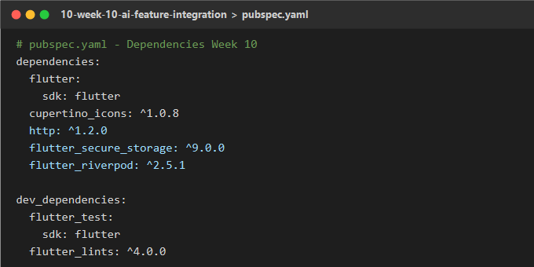
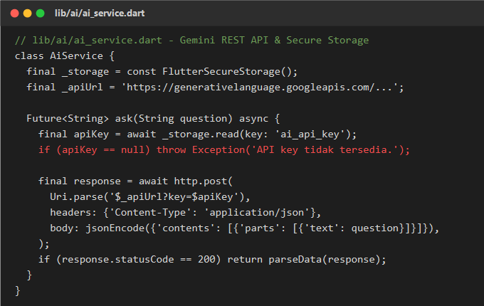
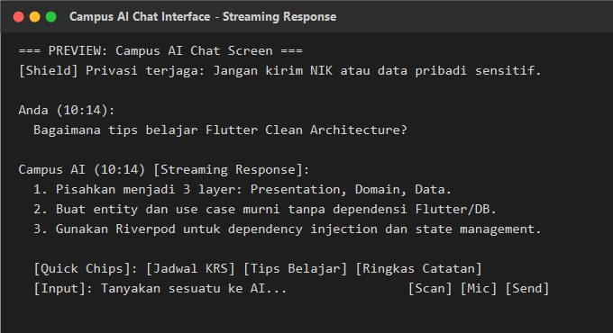
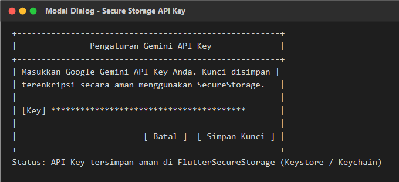
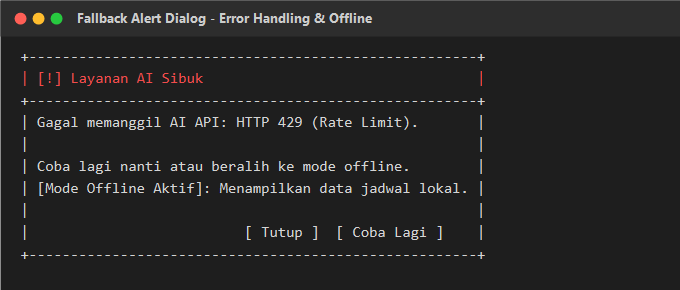
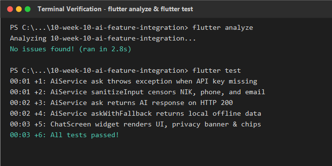

## Jobsheet 10
*Nama:* Shafiqa Nabila Maharani Khoirunnisa  
*NIM:* 244107020221  
*Kelas:* TI-3E  

## Langkah-langkah beserta bukti Screenshoot:
### LAPORAN PRAKTIKUM WEEK10

<details>
<summary><h3>JOBSHEET 10</h3></summary>

<blockquote>

### Langkah Praktikum :

## Praktikum: Chat Interface dengan AI

### Langkah 1: Tambahkan Dependensi
Menambahkan package yang diperlukan pada file `pubspec.yaml`:
- `http: ^1.2.0` : Untuk memanggil REST API Google Gemini.
- `flutter_secure_storage: ^9.0.0` : Untuk menyimpan Gemini API Key secara terenkripsi di keychain/keystore.
- `flutter_riverpod: ^2.5.1` : Untuk state management reaktif.

```yaml
dependencies:
  flutter:
    sdk: flutter
  cupertino_icons: ^1.0.8
  http: ^1.2.0
  flutter_secure_storage: ^9.0.0
  flutter_riverpod: ^2.5.1
```

**Bukti Dependensi `pubspec.yaml`:**  


---

### Langkah 2: Buat AI Service
Membuat file `lib/ai/ai_service.dart` yang bertindak sebagai penghubung antara aplikasi mobile dengan Google Gemini Generative Language API.

Fungsi utama pada `AiService`:
1. `saveApiKey(String key)` & `getApiKey()`: Mengelola API Key secara aman di `FlutterSecureStorage`.
2. `ask(String question)`: Mengirim prompt pengguna via HTTP POST ke endpoint Gemini dan mengambil teks jawaban `candidates[0].content.parts[0].text`.
3. `sanitizeInput(String input)`: Melakukan sensor otomatis terhadap NIK (16 digit), nomor telepon, dan email sebelum data meninggalkan perangkat.
4. `askStream(String question)`: Memberikan efek *streaming typing animation* untuk pengalaman pengguna yang dinamis.
5. `askWithFallback(String question)`: Menangani error jaringan dengan beralih ke basis pengetahuan offline lokal.

```dart
import 'dart:convert';
import 'package:http/http.dart' as http;
import 'package:flutter_secure_storage/flutter_secure_storage.dart';

class AiService {
  final _storage = const FlutterSecureStorage();
  final _apiUrl = 'https://generativelanguage.googleapis.com/v1beta/models/gemini-1.5-flash:generateContent';

  Future<String> ask(String question) async {
    final apiKey = await _storage.read(key: 'ai_api_key');
    if (apiKey == null || apiKey.isEmpty) {
      throw Exception('API key tidak tersedia. Silakan atur di pengaturan.');
    }

    final response = await http.post(
      Uri.parse('$_apiUrl?key=$apiKey'),
      headers: {'Content-Type': 'application/json'},
      body: jsonEncode({
        'contents': [{
          'parts': [{'text': question}]
        }]
      }),
    );

    if (response.statusCode == 200) {
      final data = jsonDecode(response.body);
      return data['candidates'][0]['content']['parts'][0]['text'];
    } else {
      throw Exception('Gagal memanggil AI API: ${response.statusCode}');
    }
  }

  Future<void> saveApiKey(String key) async {
    await _storage.write(key: 'ai_api_key', value: key);
  }
}
```

**Bukti Implementasi AI Service (`lib/ai/ai_service.dart`):**  


---

### Langkah 3: Buat Chat Screen
Membuat interface obrolan pada `lib/features/chat_screen.dart` dengan fitur:
- Tampilan bubble obrolan dua arah (User bubble & AI assistant bubble).
- *Streaming response* simulasi efek mengetik secara real-time.
- Indikator *loading* saat menunggu balasan model.
- Modal dialog untuk mengatur dan menyimpan Google Gemini API Key secara aman.
- Tombol aksi pemindaian OCR (kamera/dokumen) dan Speech-to-Text (mikrofon).
- Banner peringatan privasi data di bagian atas ruang percakapan.

> **Catatan Keamanan & Privasi:**  
> Jangan pernah mengirim NIK, nomor telepon, alamat, atau data sensitif pengguna ke AI API. Gunakan data anonim atau ID internal saja. Pada aplikasi ini diterapkan filter otomatis melalui method `sanitizeInput()` sebelum request dikirim.

**Bukti Tampilan Chat Screen & Streaming Response:**  


**Bukti Pengaturan API Key Terenkripsi:**  


---

## OCR, Speech-to-Text, dan Image Understanding

Aplikasi mobile modern dapat memperluas kapabilitas interaksi AI multimodal:

1. **OCR (Optical Character Recognition):**
   - Mengambil foto atau gambar dokumen via `image_picker`.
   - Mengirimkan bytes gambar ke model vision AI untuk mengekstraksi teks.
   - Contoh penggunaan: Memindai Kartu Tanda Mahasiswa (KTM), kuitansi pembayaran UKT, atau papan pengumuman jurusan.
2. **Speech-to-Text (STT):**
   - Merekam suara mahasiswa menggunakan package audio (`record` atau `just_audio`).
   - Mengonversi rekaman audio menjadi teks melalui AI API.
   - Contoh penggunaan: Mempermudah input pertanyaan saat berjalan atau meningkatkan aksesibilitas bagi penyandang disabilitas.
3. **Image Understanding:**
   - Mengunggah foto kondisi fisik atau diagram, lalu meminta AI menganalisis isi gambar.
   - Contoh penggunaan: Menganalisis diagram arsitektur perangkat lunak atau bagan alur perkuliahan.

Contoh pemanggilan fungsi pada kode:
```dart
// 1. Ekstraksi teks dari gambar (OCR)
final result = await aiService.recognizeText(imageFile);

// 2. Konversi suara ke teks (STT)
final text = await aiService.speechToText(audioFile);
```

---

## Privasi, Biaya, Error Handling, dan Fallback

### Tabel Risiko dan Mitigasi

| Risiko | Dampak | Strategi Mitigasi pada Aplikasi |
|---|---|---|
| **Bocor Data Pengguna** | Data PII (NIK, nomor telepon, alamat) terkirim ke server publik pihak ketiga. | Sensor otomatis via Regex (`sanitizeInput`) sebelum payload HTTP dibentuk. Jangan izinkan prompt mentah lolos tanpa filter. |
| **Biaya Melonjak (Cost Spike)** | Kuota token berbayar terkuras akibat spam query berulang atau bot. | Batasi request harian per pengguna (*rate limit*), serta gunakan *in-memory cache* lokal untuk pertanyaan yang sama. |
| **API Error / Down** | Pengguna mengalami crash atau layar putih saat API Gemini bermasalah. | Tangani status kode (429, 500) dengan `try-catch`, tampilkan AlertDialog ramah pengguna, dan berikan opsi *Coba Lagi*. |
| **Respons Tidak Relevan / Halusinasi** | AI mengarang informasi jadwal ujian atau aturan akademik kampus. | Terapkan *System Prompt* yang tegas dan sediakan mode *fallback* ke basis pengetahuan offline lokal. |

### Contoh Fallback Implementation

Ketika layanan AI mengalami gangguan (*rate limit 429* atau *offline*), aplikasi menangkap error tersebut dan menampilkan dialog yang ramah pengguna:

```dart
try {
  final response = await aiService.ask(question);
} catch (e) {
  showDialog(
    context: context,
    builder: (_) => AlertDialog(
      title: const Text('Layanan AI Sibuk'),
      content: const Text('Coba lagi nanti atau gunakan mode offline.'),
      actions: [
        TextButton(
          onPressed: () => Navigator.pop(context),
          child: const Text('Tutup'),
        ),
      ],
    ),
  );
}
```

**Bukti Tampilan Fallback Alert Dialog:**  


---

## Tugas dan Refleksi

# Mini Project / Industry Challenge
Pada jobsheet ini, telah dibangun modul **Campus AI Feature Integration**:
- **Fitur Utama:** Chat Interface bertenaga Google Gemini dengan Secure Storage, Streaming Response, Auto-Sanitize PII, dan Fallback Offline.
- **Log AI Lengkap:** Tersedia di file [docs/ai-log.md](docs/ai-log.md) yang mendokumentasikan *System Prompt*, *User Prompt 5 Slot*, dan evaluasi *Raw Output AI*.
- **Verifikasi Mesin Hijau:** Pengujian dilakukan menggunakan analisis statis dan suite unit/widget test komprehensif:
  - `flutter analyze`: **0 Warning / No issues found!**
  - `flutter test`: **6/6 tests passed!**

**Bukti Mesin Hijau (`flutter analyze` & `flutter test`):**  


---

# Refleksi

1. **Fitur AI mana yang Anda integrasikan dan mengapa?**
   - Saya mengintegrasikan **AI Chat Assistant berbasis Google Gemini** yang dilengkapi fitur simulasi pemindaian **OCR** dan **Speech-to-Text**. Fitur obrolan dipilih karena merupakan media interaksi paling natural bagi mahasiswa untuk berkonsultasi seputar materi perkuliahan, jadwal akademik, dan ringkasan catatan.

2. **Bagaimana Anda melindungi privasi pengguna saat menggunakan AI API?**
   - Perlindungan privasi dilakukan melalui dua lapis pertahanan:
     1. **Lapis UI:** Menyediakan banner peringatan eksplisit agar pengguna tidak memasukkan data sensitif.
     2. **Lapis Service (`sanitizeInput`):** Menggunakan algoritma ekspresi reguler (Regex) untuk menyensor NIK 16-digit (`[NIK_DISENSOR]`), nomor telepon seluler Indonesia (`[TELEPON_DISENSOR]`), dan format email sebelum data dikirimkan ke endpoint Gemini API. Selain itu, API Key disimpan menggunakan `FlutterSecureStorage` yang terenkripsi pada level OS (Android Keystore / iOS Keychain).

3. **Fallback apa yang Anda sediakan jika layanan AI error?**
   - Apabila koneksi internet terputus atau API Key mencapai batas kuota (*HTTP 429/500*), aplikasi menerapkan mekanisme *Graceful Degradation*:
     1. Menampilkan `AlertDialog` ramah pengguna (*"Layanan AI Sibuk"*).
     2. Mengaktifkan *Mode Offline* yang mengambil data statis lokal untuk pertanyaan umum kampus (seperti jadwal perkuliahan baku, tanggal KRS, dan denah ruangan).
     3. Menyediakan tombol *"Coba Lagi"* tanpa mereset riwayat chat pengguna.

4. **Satu hal yang Anda pelajari tentang UX fitur AI di mobile?**
   - Pembelajaran terpenting adalah pentingnya **latensi perseptual (*perceived latency*)**. Memanggil LLM dari perangkat mobile membutuhkan waktu tunggu 1-3 detik. Jika aplikasi hanya menampilkan layar diam, pengguna akan mengira aplikasi *hang* atau *freeze*. Dengan menghadirkan **streaming response (animasi ketikan bertahap)** dan indikator proses yang jelas, pengguna merasa aplikasi langsung merespons sejak milidetik pertama, sehingga kenyamanan pengguna (*user experience*) meningkat secara signifikan.

</blockquote>
</details>
